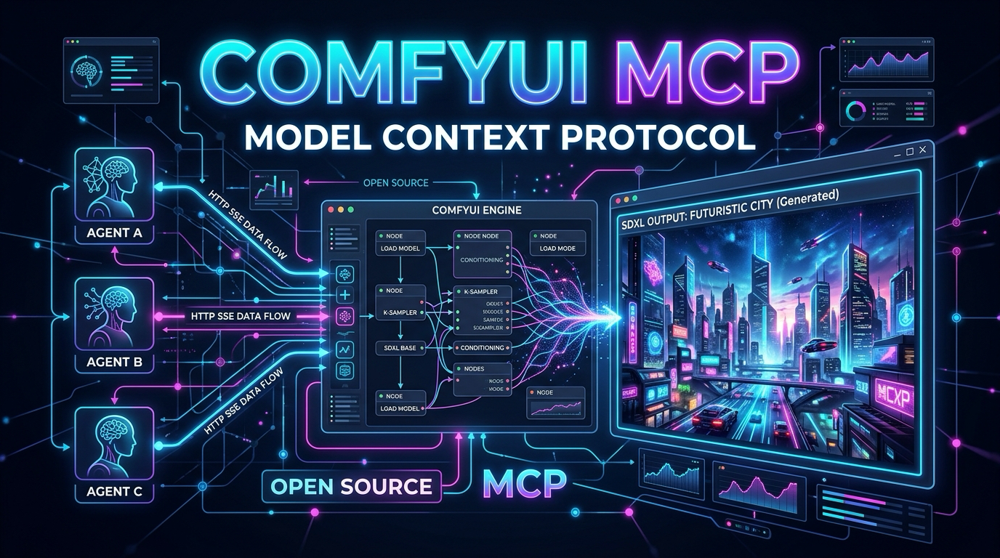

<p align="center">
  
</p>

**English** · [Español](README.md)

# ComfyUI MCP — Image Generation for AI Agents via Model Context Protocol (MCP)

> **Connect SDXL image generation capabilities to any AI agent on your network.**
> Open-source MCP server exposing ComfyUI inference (SDXL / RTX 3060) to Claude Code, Cursor, Windsurf, Hermes Gateway, and any client compatible with [Model Context Protocol](https://modelcontextprotocol.io). FastMCP HTTP/SSE + GPU Arbiter, **zero client dependencies, 100% on your hardware**.

[](LICENSE)
[](https://modelcontextprotocol.io)
[](pyproject.toml)
[](https://github.com/GermaniU/comfyui-mcp/actions/workflows/ci.yml)
[](https://github.com/jlowin/fastmcp)
[](CONTRIBUTING.md)

**Tags:** `mcp-server` · `comfyui` · `sdxl` · `image-generation` · `ai-agents` · `fastmcp` · `claude-code` · `cursor` · `hermes-gateway` · `gpu-arbiter` · `local-first` · `self-hosted`

<p align="center">
  
</p>

<p align="center"><sub>The agent asks for an image with a preset and gets the download URL — the GPU works on the server, the client installs no PyTorch.</sub></p>

---

## 💡 Why It Exists

Generating images in multi-agent environments usually requires installing heavy PyTorch dependencies, dedicated GPUs, and complex setups on every client machine. **ComfyUI MCP** solves this by acting as a decoupled HTTP/SSE middleware adapter:

- 🚀 **Zero Local Installation**: Any client or gateway consumes image generation over HTTP/SSE on port `8201` without installing PyTorch or downloading SDXL models locally.
- 🧠 **Smart GPU Arbiter**: Automatically switches between `llama-server` (LLMs) and `ComfyUI` on 12GB GPUs (RTX 3060) without VRAM collisions.
- 🎯 **Professional Presets**: Production-ready generation out of the box with presets like `producto` (RealVisXL V4.0) or `realista` (Juggernaut XL).

---

## 🏗️ Architecture & Component Boundaries

> ⚠️ **IMPORTANT: System Boundaries**
>
> `comfyui-mcp` is **strictly the MCP transport & interface layer**. It does NOT include the ComfyUI inference engine or large model weight files.
> For host server deployment instructions, see [docs/SERVER_SETUP.md](docs/SERVER_SETUP.md) and [docs/ARCHITECTURE.md](docs/ARCHITECTURE.md).

```
 +-------------------------------------------------------+
 |                 MCP Clients (LAN)                     |
 | (Claude Code CLI / Cursor / Windsurf / Hermes Gateway)|
 +-------------------------------------------------------+
                             |
                             | HTTP / SSE (Port 8201)
                             v
 +-------------------------------------------------------+
 |                  comfyui-mcp Server                   |
 |           (FastMCP + Workflow JSON Builder)           |
 +-------------------------------------------------------+
                             |
                             | Loopback HTTP (Port 8188)
                             v
 +-------------------------------------------------------+
 |                 ComfyUI Backend Host                  |
 |  (PyTorch + CUDA + SDXL Checkpoints + GPU Arbiter)    |
 +-------------------------------------------------------+
```

---

## 📦 Quickstart

### Prerequisites
- Python 3.11+
- `uv` ≥ 0.13.4 (recommended) or `pip` ≥ 26.2.2: older releases still trust the compromised emSign CA (GHSA-6q48-6c7w-9gw2). `pyproject.toml` enforces the uv floor (`[tool.uv] required-version`).

### Install

```bash
git clone https://github.com/GermaniU/comfyui-mcp.git
cd comfyui-mcp

# Create venv and install
uv venv
source .venv/bin/activate
uv pip install -e .
```

---

## ⚙️ Configuration (Environment Variables)

Create a `.env` file or export environment variables:

| Variable | Default | Description |
|----------|---------|-------------|
| `COMFYUI_URL` | `http://127.0.0.1:8188` | Loopback URL where the host ComfyUI engine is listening. |
| `COMFYUI_PUBLIC_URL` | `http://<YOUR_SERVER_IP>:8188` | Public/LAN base URL for direct client image downloads. |
| `MCP_HOST` | `0.0.0.0` | Host binding for the MCP server. |
| `MCP_PORT` | `8201` | HTTP/SSE port for the MCP server. |
| `MCP_AUTH_TOKEN` | *(empty = no auth)* | If set, requires `Authorization: Bearer <token>` header on every HTTP/SSE request. |
| `MCP_CORS_ORIGINS` | `*` | Comma-separated allowed CORS origins. Only affects browser-based clients. |
| `VIDEO_TIMEOUT_SECONDS` | `4200` | 5B wait limit after submission (includes queue and cold load). |
| `A14B_TIMEOUT_SECONDS` | `2700` | A14B wait limit after submission (includes queue and cold load). |

> **Security:** without `MCP_AUTH_TOKEN`, any host on the LAN —or a web page open in a LAN browser, with CORS `*`— can generate images and tie up the GPU. Setting a token is recommended unless the network is fully trusted.

---

## 🛠️ MCP Tool Reference

### 1. `generate_image` (txt2img)
Generates images from a text prompt using SDXL.

- **Parameters**:
  - `prompt` (*string*, required): Image description (English works best).
  - `preset` (*string*, optional): `producto`, `realista`, `rapido` or `anime`. Default: `"producto"`.
  - `aspect` (*string*, optional): `1:1`, `4:5`, `5:4`, `9:16`, `16:9`, `3:2`, `2:3` (~1MP). Default: `"1:1"`.
  - `negative_prompt` (*string*, optional): Concepts to exclude. Default: generic quality negative.
  - `seed` (*integer*, optional): Seed for reproducibility. Default: random.
  - `batch` (*integer*, optional): Images per call (1-4). Default: `1`.
  - `checkpoint`, `lora`, `lora_strength`, `steps`, `cfg` (optional): Override the preset values.
  - `filename_prefix` (*string*, optional): Output file prefix. Default: `"mcp"`.
  - `detail_face` (*bool*, optional): FaceDetailer pass (requires Impact Pack). Default: `false`.
  - `preview` (*bool*, optional): Also returns a JPEG thumbnail (~512px) so the model can see the result. Vision-capable clients only. Default: `false`.

### 2. `img2img`
Varies an already generated image (in ComfyUI's `output/`) with a denoise strength.

- **Parameters**:
  - `image_filename` (*string*, required): Generated file name (e.g. `mcp_00001_.png`).
  - `prompt` (*string*, optional): Transformation instruction. Empty = pure visual variation.
  - `denoise` (*float*, optional): `0.0` identical, `1.0` completely new. Default: `0.55`.
  - `preset` (*string*, optional): Default: `"realista"`.
  - `negative_prompt`, `seed`, `checkpoint`, `lora`, `lora_strength`, `steps`, `cfg`, `filename_prefix`, `preview` (optional).

### 3. `generate_video` (Wan 2.2)
Creates a 1-5 s MP4 clip. Without an image, Wan 2.2 TI2V 5B (~720p, 24 fps, 30 steps uni_pc/simple, CFG 5, shift 8); with `image_filename`, recommended Wan 2.2 A14B I2V GGUF at 16 fps (480×832 or 832×480). Local 5 s/121-frame 5B fp8 benchmarks took **1620.7–1903.6 s (~27–31.7 min)** across two scenes/orientations; an A14B I2V run took **489.2 s (~8.2 min)** for 81 frames with a raccoon input. These measurements are not general time or quality guarantees, nor timings for `draft`. See [SERVER_SETUP](docs/SERVER_SETUP.md#-step-2b-modelos-de-video-wan-22). This MCP integration has not yet been tested on the live GPU.

- **Parameters**:
  - `prompt` (*string*, required): Scene and motion; English recommended.
  - `aspect` (*string*, optional): A14B `16:9` (832×480), `9:16` (480×832); 5B `16:9` (1280×704), `9:16` (704×1280), `1:1` (960×960). Default `"16:9"`; explicit A14B rejects `1:1`, while `auto` selects 5B.
  - `seconds` (*integer*, optional): Clamped to 1-5. A14B 16 fps + 1 frame (81 at 5 s); 5B 24 fps + 1 frame (121 at 5 s). Default `3`.
  - `image_filename` (*string*, optional): An existing `[output]` image to animate; match the orientation. `auto` selects A14B only with an image, compatible parameters, and available ComfyUI nodes/weights; otherwise it selects 5B and reports why. Without an image it selects 5B.
  - `model` (*string*, optional): `auto` (default), `a14b` (requires an image), or `5b` (retains the previous 5B I2V and T2V path). Existing parameters remain unchanged.
  - `draft` (*bool*, optional): 5B only: keeps ~720p resolution but caps duration at 2 s (49 frames at 24 fps); no measured timing. A14B rejects `draft=true`.
  - `steps`, `cfg`: A14B fixes these to `4` and `1` with lightx2v; incompatible values are rejected for explicit A14B, while `auto` selects 5B. 5B defaults to 30 and 5; explicit values override them.
  - `negative_prompt`, `seed`, `filename_prefix` (optional). Prefix defaults to `"mcp-video"`.
  - `preview` (*bool*, optional): JPEG thumbnail of the first frame.

Configure the timeouts at server startup using the variables above. They start at submission and include queue, cold load and generation; neither response time nor cancellation is guaranteed. On expiry the client attempts to remove a pending prompt and interrupt ComfyUI, but work may continue and ComfyUI's interrupt can affect a different concurrent run. Tune for actual load and the MCP client's own timeout. `negative_prompt=null` uses the default negative; `""` disables it.

### 4. `list_models`
Returns available checkpoints, LoRAs, and presets on the ComfyUI instance.

### 5. `comfy_health`
Retrieves backend engine health: ComfyUI version, GPU VRAM usage, and queue length.

### 6. `comfy_view_url`
Constructs the direct LAN download URL for a generated image given its `filename` and `subfolder`.

---

## 🎨 Preset Matrix

| Preset | Associated Checkpoint | Steps | CFG | Primary Use Case |
|--------|----------------------|-------|-----|------------------|
| `producto` | `RealVisXL_V4.0.safetensors` | 30 | 5.5 | Photorealistic product & commercial photography (Default). |
| `realista` | `juggernautXL_ragnarokBy.safetensors` | 30 | 5.0 | Versatile photorealism (scenes, people, environments). |
| `rapido` | `juggernautXL_ragnarokBy.safetensors` + SDXL-Lightning LoRA | 6 | 1.5 | Draft previews in ~5 seconds. |
| `anime` | `animagine-xl-3.1.safetensors` | 28 | 7.0 | Anime-style illustration (checkpoint not shipped on the server). |

---

## 🧭 How does it compare to other ComfyUI MCP servers?

There are three families, and they solve different problems. This one doesn't compete with the other two: it complements them.

| | **ComfyUI MCP** (this) | *Workflow-graph* servers | Cloud image APIs |
|---|---|---|---|
| What you send | A **prompt + preset** (`producto`, `realista`, `rapido`, `anime`) | A **node graph** in JSON (you design it) | A prompt to a remote service |
| ComfyUI knowledge | None | Required | None |
| Where it runs | Your GPU (RTX 3060) | Your GPU | A third party's server |
| Cost per image | 0 (your electricity) | 0 | Per image, per vendor |
| Privacy | The prompt never leaves your network | Same | Your prompt goes to the cloud |
| Shares the GPU with the LLM | **Yes** (GPU Arbiter, 12 GB) | Depends | N/A |
| Client | HTTP/SSE on the LAN + stdio — **zero PyTorch on the client** | Usually local stdio | HTTP |

**In one sentence:**
- If you need full control over the node graph → a *workflow-graph* server (e.g. `comfy-pilot`).
- If you have no GPU and don't mind paying per image → a cloud API (Flux, Nano Banana, GPT-image).
- If you have the GPU and want to **generate without learning ComfyUI**, sharing the card with your LLM → this one.

---

## 🔗 Client Integration Guides

### Claude Code CLI (`~/.claude.json`)

```json
{
  "mcpServers": {
    "comfyui": {
      "url": "http://<YOUR_SERVER_IP>:8201/mcp"
    }
  }
}
```

### Hermes Gateway (`~/.hermes/config.yaml`)

```yaml
mcp_servers:
  comfyui:
    url: "http://<YOUR_SERVER_IP>:8201/mcp"
    transport: "http"
```

---

## 🧪 Running Tests

```bash
uv run --with pytest --with pytest-asyncio pytest
```

---

## 📄 License

This MCP code is MIT licensed ([LICENSE](LICENSE)); it does **not** license or distribute model weights. The original [Wan 2.2 TI2V-5B](https://huggingface.co/Wan-AI/Wan2.2-TI2V-5B) and [Wan 2.2 I2V-A14B](https://huggingface.co/Wan-AI/Wan2.2-I2V-A14B) repositories state Apache 2.0 for their models. ComfyUI repackagings, third-party GGUF and LoRA may carry separate terms; check each distribution before downloading, redistributing or commercial use. See [SERVER_SETUP](docs/SERVER_SETUP.md#-step-2b-modelos-de-video-wan-22) for requirements and exact filenames.
